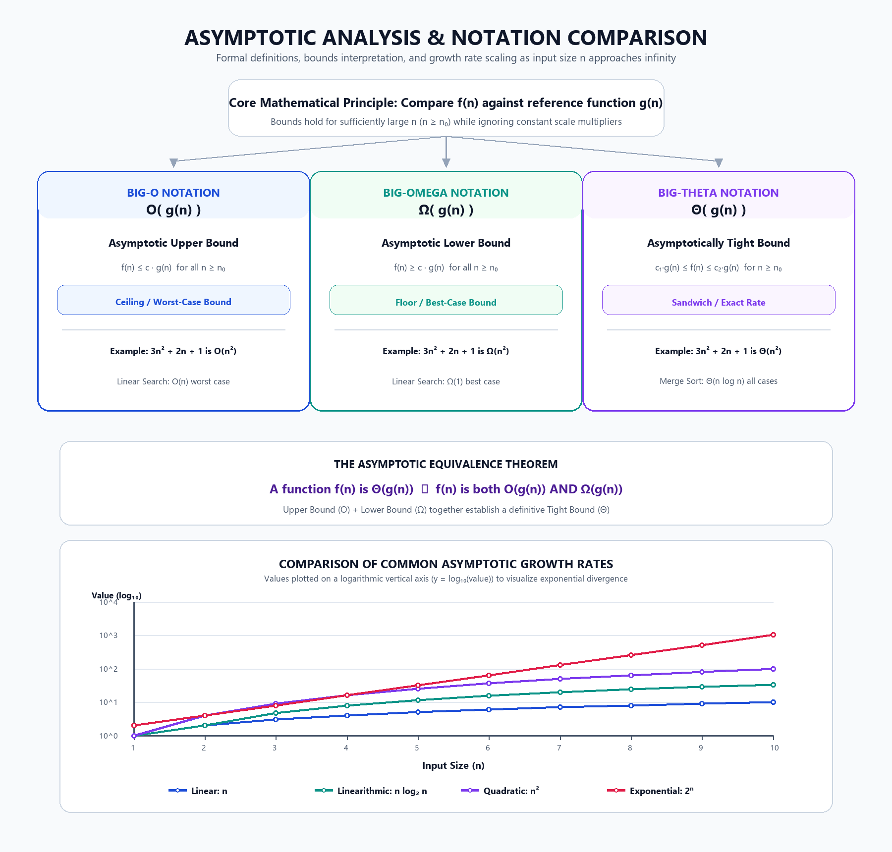

# Asymptotic Notations and Growth Rate Analysis

## Description
This project focuses on **Asymptotic Analysis** in Design and Analysis of Algorithms (DAA) and visualizes the comparative growth rates of mathematical functions through prompt engineering and Python graphic rendering.

Asymptotic analysis evaluates how an algorithm's resource consumption (time or memory) behaves as the problem input size \( n \) approaches infinity. Instead of measuring physical run times (which depend heavily on CPU clock speed, memory, compiler flags, and operating system load), asymptotic analysis classifies algorithms by their intrinsic rate of growth. This project compares the three standard notations—**Big-O** (Upper Bound), **Big-Omega** (Lower Bound), and **Big-Theta** (Tight Bound)—demonstrates their algebraic inequalities on polynomial expressions, and contrasts standard complexity curves on a semi-logarithmic scale.

---

## Algorithm & Mathematical Formulations

### 1. Formal Asymptotic Definitions

Given an algorithm's running-time function \( f(n) \) and a reference function \( g(n) \):

| Notation | Formal Definition | Graphical Meaning | Intuition |
| :--- | :--- | :--- | :--- |
| **Big-O** \( O(g(n)) \) | \( \exists\ c > 0, n_0 \ge 1 \text{ s.t. } 0 \le f(n) \le c \cdot g(n) \quad \forall\ n \ge n_0 \) | Upper Bound | Worst-case ceiling |
| **Big-Omega** \( \Omega(g(n)) \) | \( \exists\ c > 0, n_0 \ge 1 \text{ s.t. } 0 \le c \cdot g(n) \le f(n) \quad \forall\ n \ge n_0 \) | Lower Bound | Best-case floor |
| **Big-Theta** \( \Theta(g(n)) \) | \( \exists\ c_1, c_2 > 0, n_0 \ge 1 \text{ s.t. } c_1 \cdot g(n) \le f(n) \le c_2 \cdot g(n) \quad \forall\ n \ge n_0 \) | Tight Bound | Exact growth rate |

### 2. Equivalence Theorem
A function \( f(n) \) is asymptotically tight if and only if it is simultaneously bounded from above and below by the same reference function:
\[
f(n) = \Theta(g(n)) \iff f(n) = O(g(n)) \quad \text{and} \quad f(n) = \Omega(g(n))
\]

### 3. Step-by-Step Polynomial Analysis
Consider the function \( f(n) = 3n^2 + 2n + 1 \):
- For large values of \( n \), the quadratic term \( 3n^2 \) dominates the linear term \( 2n \) and the constant term \( 1 \).
- **Upper Bound (\(O\))**: For \( n \ge 1 \):
  \[
  3n^2 + 2n + 1 \le 3n^2 + 2n^2 + 1n^2 = 6n^2 \implies c = 6, n_0 = 1 \implies f(n) \in O(n^2)
  \]
- **Lower Bound (\(\Omega\))**: For \( n \ge 1 \):
  \[
  3n^2 + 2n + 1 \ge 3n^2 \implies c = 3, n_0 = 1 \implies f(n) \in \Omega(n^2)
  \]
- **Tight Bound (\(\Theta\))**: Since \( 3n^2 \le f(n) \le 6n^2 \) for \( n \ge 1 \), \( f(n) \in \Theta(n^2) \).

### 4. Algorithm Case Studies
- **Linear Search**:
  - Best Case: Target found at first element (\( \Omega(1) \)).
  - Worst Case: Target at last position or absent (\( O(n) \)).
  - Not \(\Theta(n)\) unconditionally because best and worst cases diverge.
- **Merge Sort**:
  - Divides problem in half and merges sorted halves in linear time across all inputs.
  - Recurrence: \( T(n) = 2T(n/2) + \Theta(n) \).
  - Best, Average, and Worst Case all run in \( \Theta(n \log n) \).

---

## Prompt Used
“Create a professional academic visualization and comparison chart for Asymptotic Notations (Big-O, Big-Omega, Big-Theta) in Design and Analysis of Algorithms. At the top, provide clean structured reference cards for each notation with formal definitions, inequalities, intuitive mnemonics (upper bound ceiling, lower bound floor, tight bound), and real algorithm examples (Linear Search and Merge Sort) along with polynomial function f(n) = 3n^2 + 2n + 1. In the middle section, clearly highlight the equivalence theorem: f(n) is Theta(g(n)) if and only if f(n) is both O(g(n)) and Omega(g(n)). At the bottom, include a precision coordinate graph comparing standard growth curves n, n log2(n), n^2, and 2^n for input sizes n = 1 through 10, using a logarithmic vertical scale so all curves remain distinct and readable. Use an elegant academic color palette with color-coded notation borders and distinct curve lines suitable for a B.Tech Computer Science project.”

---

## Output



### Terminal Execution Output:
```text
============================================================
    ASYMPTOTIC GROWTH & NOTATION ANALYSIS (UNIT 1)
============================================================
Analyzing Polynomial Function: f(n) = 3n^2 + 2n + 1
  - Highest-Order Dominant Term : n^2
  - Asymptotic Upper Bound      : O(n^2)
  - Asymptotic Lower Bound      : Omega(n^2)
  - Asymptotically Tight Bound  : Theta(n^2)
------------------------------------------------------------
Growth Rates for Sample Input (n = 10):
  - Linear        : n          = 10
  - Linearithmic  : n log2(n)  = 33.22
  - Quadratic     : n^2        = 100
  - Exponential   : 2^n        = 1024
Hierarchy : n < n log2(n) < n^2 < 2^n
------------------------------------------------------------
Visualization graphic successfully generated: Visualization.png
============================================================
```

To regenerate the graphic and run the analysis:
```bash
python Project3_AsymptoticGrowth.py
```

---

## Growth Hierarchy Summary

In order of increasing computational complexity:
\[
O(1) < O(\log n) < O(n) < O(n \log n) < O(n^2) < O(n^3) < O(2^n) < O(n!)
\]

A logarithmic vertical axis (\( y = \log_{10}(\text{value}) \)) is critical when graphing these functions together: at \( n = 10 \), the exponential curve \( 2^{10} = 1024 \) is two orders of magnitude higher than linear \( n = 10 \). The logarithmic scale keeps all functions clearly visible and readable.

---

## Learning Outcome
- Mastered formal definitions and algebraic inequalities for Big-O, Big-Omega, and Big-Theta notations.
- Understood why lower-order terms and constant coefficients are eliminated in asymptotic analysis.
- Verified how upper and lower bounds combine to establish an asymptotically tight bound.
- Analyzed comparative algorithm complexities (Linear Search vs. Merge Sort).
- Generated a high-resolution concept map and semi-logarithmic growth chart.
